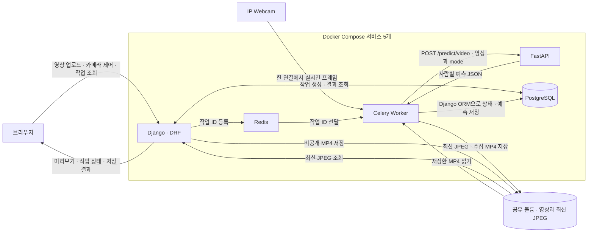
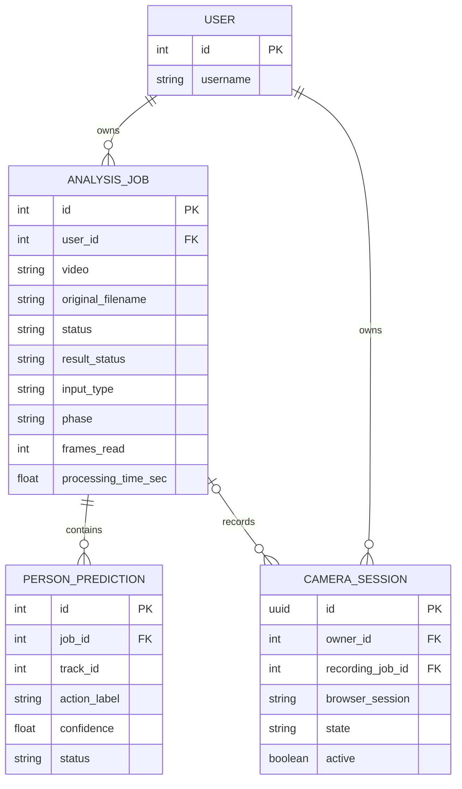
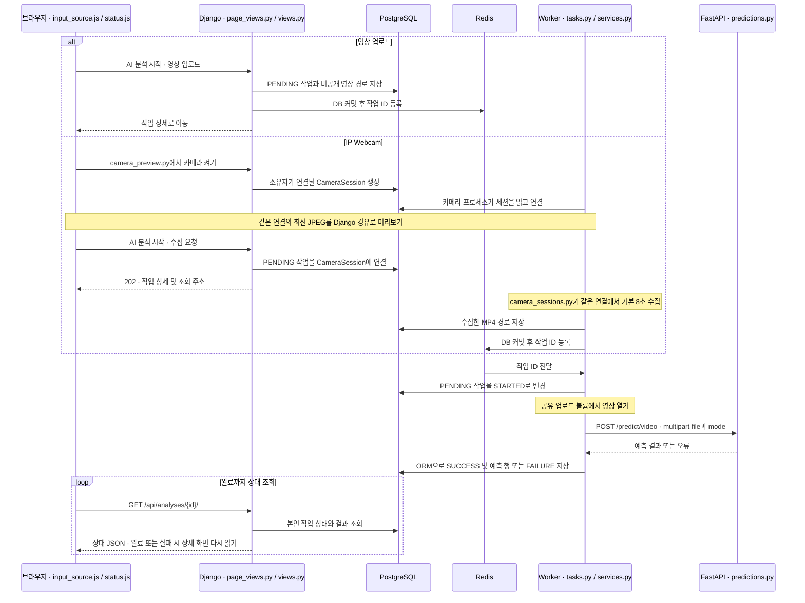

# Vision Action Platform

## 1. 프로젝트 소개

Vision Action Platform은 업로드한 영상이나 IP Webcam에서 수집한 영상에서 사람을 추적하고, 관절 움직임으로 동작을 분류하는 교과 10 프로젝트다. 로그인한 사용자는 분석을 요청하고 본인 작업의 진행 상태와 사람별 추적 ID, 동작 라벨, 점수를 확인할 수 있다. 분석 화면은 밝은 테마와 다크 테마를 제공하며, 설정은 같은 브라우저에 유지된다.

## 2. 실행 방법

Docker 엔진과 Compose를 사용할 수 있는 WSL의 저장소 루트에서 실행한다.

1. `ai_service/models/`를 만들고 [6절의 파일 4개](#6-사용한-모델과-입력-형식)를 준비한다. FastAPI는 이 폴더를 읽기 전용으로 사용한다.
2. `.env`가 없으면 `cp .env.example .env`로 만들고, `DJANGO_SECRET_KEY`와 `POSTGRES_PASSWORD`에 직접 생성한 값을 입력한다. 이미 `.env`가 있으면 필요한 항목만 확인한다. 실제 `.env`는 로컬에 보관한다.
3. 다음 명령으로 Compose 설정을 확인하고 서비스 5개를 시작한다. Django는 시작할 때 `python manage.py migrate --noinput`으로 PostgreSQL에 마이그레이션을 적용한다.

   ```bash
   docker compose config --quiet
   docker compose up --build -d
   docker compose ps
   ```

4. 기본 사용자 화면 [http://127.0.0.1:8012/](http://127.0.0.1:8012/)에서 회원가입 → 로그인 → 영상 업로드 또는 IP Webcam 선택 → **AI 분석 시작** 순서로 진행한다. 작업 번호와 상태가 먼저 표시되고, 완료하면 저장된 결과를 볼 수 있다. 다른 포트를 쓰려면 `.env`의 `VISION_HTTP_PORT`를 바꾼다.
5. 관리자 계정은 `docker compose exec django python manage.py createsuperuser`로 생성한다. 관리자 접속 주소는 [http://127.0.0.1:8012/admin/](http://127.0.0.1:8012/admin/)이다.
6. 로그는 `docker compose logs django celery fastapi`로 확인한다. 종료할 때는 `docker compose down`을 사용한다. 이 명령은 DB·업로드·큐 볼륨을 유지한다.

IP Webcam을 사용하려면 로컬 `.env`에 `IP_WEBCAM_URL`을 설정한다. Compose는 이 값을 Worker에만 전달한다. 분석 홈에서 **카메라 켜기**로 실시간 미리보기를 확인하고, **AI 분석 시작**으로 같은 연결에서 기본 8초를 수집한다. 녹화는 15fps MP4이며 `IP_WEBCAM_CAPTURE_SECONDS`는 5~10초로 설정할 수 있다. 수집 중에는 끄기가 제한된다. 수집이 끝난 뒤 카메라를 끄면 연결이 닫히고 저장된 영상의 분석은 계속된다.

회원은 본인 분석만 조회할 수 있다. 미리보기와 카메라 제어는 카메라를 연 회원의 로그인 세션에 묶인다. 활성 직원은 [직원 대시보드](http://127.0.0.1:8012/dashboard/)에서 상태별 작업 수, 동작·`UNKNOWN` 집계, 최근 작업 8건을 볼 수 있다. Django Admin은 직원 권한과 모델별 권한을 적용한다.

이 Compose 구성은 로컬 실습용이며 Django만 호스트 루프백에 공개한다. 기존 3단계 동기 시연은 별도의 로컬 Django 개발 환경에서 `ANALYSIS_MODE=sync`로 실행할 수 있다.

## 3. 전체 아키텍처

Compose는 Django, Redis, Celery Worker, FastAPI, PostgreSQL을 실행한다. Django와 Worker는 업로드 볼륨을 공유한다.



## 4. DB 설계(ERD)

Django 기본 사용자가 분석 작업을 소유한다. 작업은 영상 경로·원래 파일명과 처리 상태를 담고, 사람별 예측 행은 추적 ID·라벨·점수를 담는다. 같은 작업 안에서 추적 ID는 유일하다. 카메라 세션에는 소유자와 브라우저 세션, 활성 상태와 수집 중인 작업을 연결할 수 있다. 프로젝트 모델은 [backend/analyses/models.py](backend/analyses/models.py)에 있다.



예를 들어 한 영상에서 추적 ID 두 개에 대한 결과가 반환되면, 분석 작업 한 건에 사람별 예측 두 행이 연결된다. 점수가 없는 결과는 `confidence`를 비워 둘 수 있다.

## 5. AI 추론 버튼 구현 흐름



브라우저 제출은 상세 페이지로 이동하는 HTTP 302를 받는다. DRF API 제출은 작업 ID와 상세 주소를 포함한 HTTP 201을 반환한다. 브로커 등록이 실패하면 서버는 해당 작업을 `FAILURE`로 기록한다.

## 6. 사용한 모델과 입력 형식

앞선 교과 10 실습의 YOLO Pose 가중치와 Day06에서 학습한 Random Forest를 재사용했다. YOLO는 관절 좌표를 추출하고 ByteTrack은 영상 안에서 사람별 추적 ID를 유지한다. Random Forest는 추적 ID별로 30시점 × 38개 특징으로 만든 1,140개 값을 받아 동작을 분류한다.

실습 산출물에서 아래 4개를 가져와 이름을 그대로 `ai_service/models/`에 복사한다.

| 파일 | 준비할 곳과 용도 |
| --- | --- |
| `yolo11n-pose.pt` | 교과 10 Pose 실습 루트의 가중치. 관절 추출에 사용 |
| `rf_action_baseline.joblib` | 실습의 `artifacts/day06/`. 학습된 동작 분류기 |
| `rf_feature_columns.json` | 같은 `artifacts/day06/`. 모델에 넣을 특징 이름과 순서 |
| `rf_training_info.json` | 같은 `artifacts/day06/`. 학습 모델의 클래스와 입력 정보 |

[verify_stage1.py](ai_service/verify_stage1.py)는 지정된 모델의 SHA-256과 특징 순서, 클래스 정보를 검사한다. 정확히 같은 실습 산출물을 준비해야 하며 이 파일들은 저장소와 빌드 이미지에 포함하지 않는다. 원본 영상, 개인 업로드, 로컬 환경, 비밀값 파일도 제외한다.

- **지원 동작** — 허리 굽혔다 펴기(`bend_return`), 다리 들었다 내리기(`leg_raise_lower`), 걷다가 돌아서 걷기(`walk_turn_walk`), 마시고 정면으로 돌아오기(`drink_return`), 앉았다 일어서기(`sit_stand`), 손 흔들기(`wave`).
- **업로드** — MP4, MOV, MKV, WebM, AVI를 받는다. Django 업로드는 `mode=upload`를 전송한다. 추적 ID별 첫 유효 프레임부터 마지막 유효 프레임까지를 실제 프레임 간격으로 30시점 × 38개 특징으로 보간한다. 최소 유효 자세 10프레임, 구간 유효 비율 60% 이상, 유효 관측 사이 간격 2초 이하가 필요하다. 업로드 최대 크기는 64 MiB이며, 60초·3,600 디코딩 프레임·32,768 추적 관측 한도를 적용한다.
- **Swagger와 Webcam** — FastAPI를 로컬에서 별도로 실행한 경우 `/docs`에서 `POST /predict/video`의 multipart `file`과 `mode`를 지정할 수 있다. 일반 업로드와 같은 처리를 확인하려면 `upload`를 명시한다. `webcam` 또는 필드 생략은 MP4만 받으며 최근 5초 창 안에서 최소 4초를 확보하는 규칙을 적용한다. Django는 Webcam 녹화에 `webcam`을 명시한다. 기본 Compose에서는 FastAPI 포트를 호스트에 공개하지 않는다.
- **형식과 코덱** — 격리 검증에서 MP4 샘플과 MOV/MPEG-4 Part 2, MKV/FFV1, WebM/VP8, AVI/MJPEG 조합을 디코딩했다. 지원 확장자 안에서도 디코더가 없는 코덱이나 손상 파일은 `422 INVALID_VIDEO`, 확장자와 실제 컨테이너가 다르면 `415 VIDEO_FORMAT_MISMATCH`, 처리 한도를 넘으면 `413`으로 안내한다. 업로드 화면의 실패 안내에 따라 확장자와 파일 상태를 확인하거나 짧은 영상으로 다시 제출할 수 있다.
- **출력** — 읽은 프레임 수, AI 처리 시간, 추적 ID별 동작 라벨·점수·상태를 반환한다. 분류 최고 점수가 0.55 미만이거나 유효한 관절 구간이 부족하면 `UNKNOWN`을 반환할 수 있다.

## 7. 실행 결과와 검증

| 사례 | 확인한 입력과 결과 |
| --- | --- |
| 정상 처리 | 별도 Compose 리뷰에서 실제 Redis → Celery → FastAPI → PostgreSQL 경로를 확인했다. `a02_s07_e01.mp4`의 작업이 `SUCCESS`로 저장됐고, Track 1 결과는 `UNKNOWN`(점수 0.39)이었다. `SUCCESS`는 처리와 저장의 완료 상태이며, 0.39는 해당 추적의 모델 점수다. |
| 실패 처리 | 4단계 격리 검증에서 손상된 MP4를 제출했을 때 FastAPI가 HTTP 422를 반환했고, Django는 `FAILURE / INVALID_VIDEO`를 저장했다. 이 사례는 실제 FastAPI와 격리된 Worker·SQLite를 연결해 확인했다. |
| 재시작 후 보존 | 별도 Compose 리뷰에서 PostgreSQL 컨테이너를 재시작한 뒤 같은 분석 작업과 저장된 예측을 다시 조회했다. |

브로커 등록 오류, 일반적인 HTTP 오류 및 타임아웃은 실패로 기록한다. Worker가 강제 종료된 뒤 남은 `STARTED` 작업의 복구 절차는 이후 작업 범위다.

### 이후 확인한 사례

- **이전 스마트폰 실기기 시연(32771)** — 카메라 영상이 120프레임으로 처리됐고 유효 자세 107프레임, `UNKNOWN`(0.27) 결과를 저장했다.
- **사용자 미리보기 확인(32772·8012)** — 스마트폰 카메라로 샘플 MOV가 재생되는 화면을 비춰 미리보기를 확인했다. 실제 사람이 동작하는 촬영 시연은 남아 있다.
- **모의 스트림 격리 검증** — 로컬 스트림과 Chrome으로 미리보기 2.4초에 26장을 표시해 약 10.8fps를 측정했다. 이 값은 브라우저에서 본 미리보기 속도다. 분석용 MP4는 별도로 15fps로 기록했고 같은 소스 연결에서 120프레임을 저장했다.
- **최신 업로드 코드 격리 검증** — 다섯 형식의 대표 샘플을 Django → Celery 메모리 큐 → FastAPI → 임시 SQLite로 처리해 `SUCCESS` 저장과 재조회를 확인했다. 위장·손상 입력은 `FAILURE`로 기록됐다. 3.80초 샘플의 `upload` 호출은 96프레임에서 `UNKNOWN`(약 0.32)을 반환했고, 같은 MP4의 `webcam` 호출은 `INSUFFICIENT_DURATION`으로 기록됐다. 이 사례는 입력 처리의 확인 결과이며 분류 정확도는 별도 평가가 필요하다.

삼각대로 실제 사람이 동작하는 시연, 최신 코드의 8012 반영 및 Docker 통합 재확인, 최종 제출용 정상·실패·관리자 화면과 대시보드 캡처가 남아 있다.
